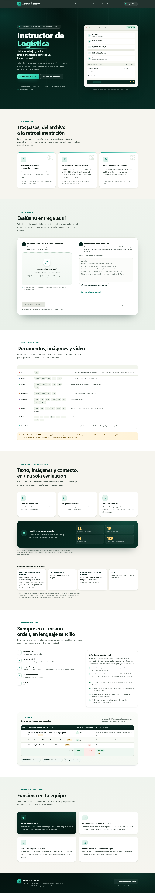
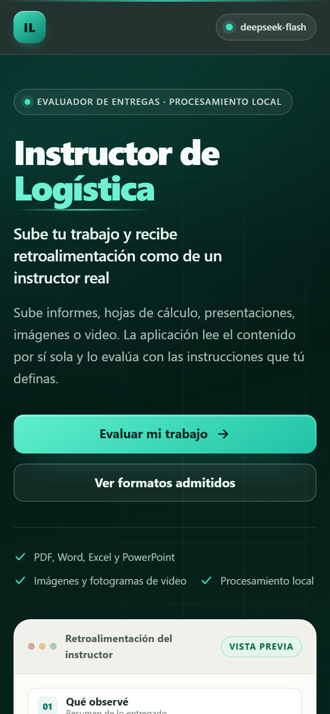

# Instructor de Logística

Aplicación local que evalúa trabajos y devuelve **retroalimentación como la de un instructor humano**: sencilla, directa y ajustada a las instrucciones que tú definas.

El usuario **solo sube el archivo**. No hay que digitar ni copiar datos del documento: la aplicación lee el contenido por sí sola (texto, tablas, imágenes, diapositivas y hasta fotogramas de video) y genera una retroalimentación estructurada con una **lista de verificación** al final.



<p align="center">
  
</p>

## Qué es

- **Evaluación asistida por IA con criterio docente.** El modelo recibe tu rúbrica o instrucciones y el contenido real del trabajo, y responde con aciertos, mejoras, recomendaciones y una calificación cuando la pides.
- **Multimodal de verdad.** Además del texto, se envían al modelo las imágenes incrustadas, las páginas escaneadas y los fotogramas de video; el prompt exige revisarlas y usarlas como evidencia.
- **Local y sin instalación compleja.** Corre en tu equipo con Node.js; la interfaz no carga recursos externos (sin CDN, sin fuentes ni imágenes remotas) y las dependencias binarias están en `vendor/`.
- **Tabla de verificación fiel a tu rúbrica.** La tabla copia el formato de tus instrucciones (casillas, puntajes o conceptos), calcula el total y se puede copiar o descargar.
- **Sin dependencias npm en el código.** El servidor usa solo módulos nativos de Node (`http`, `FormData`, `fetch`, `zlib`); no hay `node_modules` que instalar más allá de las piezas binarias fijadas.

## Cómo se usa

1. Doble clic en **`Iniciar.bat`** (o ejecuta `node lib/server.js --open`).
2. Se abre el navegador en `http://127.0.0.1:5599`.
3. **Paso 1:** arrastra o selecciona el documento a evaluar.
4. **Paso 2:** escribe las instrucciones de evaluación **o** súbelas como archivo (PDF, Word, Excel, imagen…). Si lo dejas vacío, se aplica un criterio general de logística. También puedes añadir un contexto adicional.
5. Pulsa **Evaluar mi trabajo** y lee la retroalimentación. Puedes copiarla o descargarla.

Para cerrar la aplicación: `Ctrl + C` en la ventana negra. Si el puerto 5599 está ocupado, la aplicación prueba el siguiente puerto libre y muestra la dirección final en consola.

> La aplicación avisa si el servidor local se detiene: el indicador de estado cambia a **«Servidor detenido»** y la página explica qué hacer (lo comprueba cada 20 segundos).

## Requisitos

| Requisito | Detalle |
|---|---|
| Sistema | Windows 10/11 x64 (los binarios instalados por el script son `win32-x64`) |
| Node.js | **22.13 o superior** (`engines.node: >=22.13.0`, requisito de PDF.js 6.3.289). Recomendado Node 24; ver la nota sobre PDF.js en `vendor/README.md` |
| Internet | Solo para instalar `vendor/` la primera vez y para enviar la evaluación al modelo de IA |
| Clave de API | De DeepSeek (o un endpoint compatible con OpenAI) con acceso a un modelo que acepte imágenes |

## Instalación

El repositorio en GitHub es **liviano a propósito**: los binarios de `vendor/` no están en Git porque superan los 100 MB. Al clonar el proyecto, instálalos con el script (versiones fijadas), o simplemente abre `Iniciar.bat`: si detecta que faltan, los instala automáticamente.

### Opción A — automática (recomendada)

```bat
Iniciar.bat
```

Si falta `vendor/`, el lanzador llama a `tools/preparar-vendor.ps1` y continúa cuando termina. La primera vez necesita conexión a internet.

### Opción B — manual

```powershell
git clone https://github.com/MrCastilloF/instructor-logistica.git
cd instructor-logistica
powershell -NoProfile -ExecutionPolicy Bypass -File tools\preparar-vendor.ps1
Iniciar.bat
```

También puedes usar `npm run preparar-vendor` (el script se ejecuta igual, con `-ExecutionPolicy Bypass`).

### Qué instala el script

| Dependencia | Versión fijada | Destino |
|---|---|---|
| `pdfjs-dist` | `6.3.289` | `vendor/pdfjs-dist/` (build legacy + fuentes, CMaps, wasm e ICC) |
| `@napi-rs/canvas` + `@napi-rs/canvas-win32-x64-msvc` | `1.0.9` | `vendor/node_modules/@napi-rs/` |
| `ffmpeg.exe` | 6.0 *essentials* (build de gyan.dev, vía npm `ffmpeg-static@5.2.0`) | `vendor/bin/ffmpeg.exe` |

El script trabaja en `data/tmp/vendor-build`, copia solo lo necesario, verifica el resultado y es idempotente:

```powershell
powershell -NoProfile -ExecutionPolicy Bypass -File tools\preparar-vendor.ps1 -Check   # solo verificar
powershell -NoProfile -ExecutionPolicy Bypass -File tools\preparar-vendor.ps1 -Force   # reinstalar
```

FFmpeg se instala desde el paquete npm fijado `ffmpeg-static@5.2.0`, que incluye la build 6.0 *essentials* de gyan.dev; si npm falla, el script descarga como respaldo el ZIP *release essentials* de gyan.dev. Detalles, alternativa manual y licencias en [`vendor/README.md`](vendor/README.md).

Verifica que todo quedó bien con:

```powershell
npm run doctor
```

## Formatos admitidos

| Categoría | Extensiones | Cómo se analiza |
|---|---|---|
| PDF | `.pdf` | Texto real; si es **escaneado** (sin texto) se convierte cada página a imagen y se analiza visualmente |
| Word | `.docx`, `.docm`, `.doc`, `.rtf`, `.odt` | Texto, tablas, encabezados y notas al pie |
| Excel | `.xlsx`, `.xlsm`, `.xls`, `.ods`, `.csv`, `.tsv` | Rejilla de celdas reconstruida con referencias (A1, B2…) |
| PowerPoint | `.pptx`, `.ppsx`, `.ppt`, `.odp` | Texto por diapositiva + notas del orador |
| Imágenes | `.png`, `.jpg`, `.webp`, `.gif`, `.bmp`, `.tif`, `.heic`, `.avif` | Análisis visual directo |
| Video | `.mp4`, `.mov`, `.avi`, `.mkv`, `.webm`, `.m4v`, otros | Fotogramas distribuidos en toda la línea de tiempo |
| Texto | `.txt`, `.md`, `.log`, `.json`, `.xml`, `.html`, `.srt`, `.vtt` | Lectura directa |
| Incrustados | — | Los diagramas, tablas y capturas dentro de Word/PPT/Excel se adjuntan como imagen |

> **Formatos antiguos de Office (`.doc`, `.xls`, `.ppt`):** se intenta recuperar el texto, pero la lectura puede ser parcial. Si la retroalimentación sale incompleta, guarda el archivo como PDF o en formato moderno y vuelve a subirlo. La aplicación te avisa cuando esto ocurre.

## Qué analiza

Por cada archivo, la aplicación extrae automáticamente:

- **Texto** del documento (con tablas y estructura).
- **Imágenes** relevantes: páginas escaneadas, diagramas incrustados, capturas y fotogramas de video.
- **Datos de contexto**: número de páginas, palabras, hojas, diapositivas, duración del video, resolución, si trae audio, etc.

### Análisis de imágenes dentro de los documentos

La aplicación es **multimodal**: además del texto, envía al modelo las imágenes para que las analice. No hay que activar nada.

| Situación | Qué hace |
|---|---|
| **Word / PowerPoint / Excel con imágenes** | Extrae **todas** las imágenes incrustadas (diagramas, tablas, capturas, fotografías, firmas, iconos) y las envía al modelo, priorizando las de mayor tamaño |
| **PDF escaneado** (sin texto) | Convierte **todas** las páginas a imagen |
| **PDF con texto que además trae imágenes** | Detecta **qué páginas contienen imágenes** y las convierte, conservando también el texto |
| **PDF con texto sin imágenes** | Solo texto, para no gastar cupo innecesariamente |
| **Formatos exóticos** dentro de Office (TIFF, BMP, EMF, WMF, SVG) | Los convierte a PNG para poder analizarlos |
| **Video** | Fotogramas distribuidos en toda la línea de tiempo |

Solo se descartan las imágenes **verdaderamente decorativas**: puntos de menos de 32×32 píxeles, líneas y separadores, y las que se repiten idénticas. Todo lo demás se conserva, incluso iconos pequeños.

El mensaje que se envía al modelo incluye la instrucción explícita de **revisar cada imagen** y usar como evidencia lo que se ve en ellas (cifras, cargos, pasos del proceso, firmas, fechas), mencionando si contradicen o confirman el texto.

**Cupos:** hasta 22 imágenes por evaluación (16 incrustadas y 14 páginas de PDF como máximo, compartiendo el cupo total). Si el documento trae más, se envían las principales y la aplicación lo advierte en los detalles del análisis.

## Cómo funciona

```text
Navegador → POST /api/evaluar → job en memoria → SSE /api/progreso
          → extracción (PDF/Office/imagen/video) → modelo de IA
          → retroalimentación + lista de verificación → panel de resultado
```

El servidor arranca un trabajo por evaluación, informa el progreso en vivo por *Server-Sent Events* y guarda el resultado para que la interfaz lo recoja por `/api/resultado/<id>`. Los archivos temporales de cada trabajo se borran al terminar.

El detalle técnico (módulos, endpoints, decisiones y límites) está en [`docs/arquitectura.md`](docs/arquitectura.md).

## Estructura de la retroalimentación

La respuesta sigue siempre el mismo orden, en lenguaje sencillo y en segunda persona:

1. **Qué observé** — resumen de lo entregado.
2. **Lo que está bien** — aciertos concretos, citando la evidencia del documento.
3. **Lo que hay que mejorar** — punto por punto: qué falta, por qué importa en logística y cómo corregirlo.
4. **Recomendaciones** — acciones prácticas y medibles.
5. **Cierre** — un comentario de ánimo, realista.

Si tus instrucciones piden una nota o porcentaje, la calcula y la justifica. Si no lo piden, no inventa calificaciones numéricas y evalúa con criterio cualitativo.

## Lista de verificación final (tabla)

Al final de **toda** evaluación la aplicación dibuja la tabla de verificación. La tabla **copia el formato de tus instrucciones**: si tu rúbrica es de casillas, sale con casillas; si es de puntaje, sale con puntaje.

**Si tus instrucciones son de lista de chequeo** (Cumple / No cumple, Sí / No, Aplica / No aplica), la tabla sale así:

| No. | Variables / indicadores de logro | CUMPLE SÍ | CUMPLE NO | Observaciones |
|---|---|---|---|---|
| 1 | Identificó la jerarquía de los cargos en el organigrama institucional. `20%` | ✓ 20% | | Incluye organigrama y tabla de niveles estratégico, táctico y operativo. |
| 2 | Interpretó las necesidades del departamento humano. `20%` | ✓ 20% | | Define necesidades de personal por área. |
| 3 | Diseñó el plan de acción con responsables y fechas. `20%` | | ✓ | No se definen responsables ni fechas. |
| | **TOTAL** | 2 de 3 | 1 de 3 | `Aprobado` · 3.3 de 5 |

**Si tus instrucciones dan puntajes**, sale con una sola columna de calificación mostrada como `obtenido / máximo`:

| No. | Criterio | CALIFICACIÓN | Observaciones |
|---|---|---|---|
| 1 | Claridad | `24 / 30` | Redacción clara y ordenada. |
| 2 | Análisis de causas | `7 / 40` | No explica el porqué de las desviaciones. |
| | **TOTAL** | 31 / 70 | `Reprobado` · 1.7 de 5 |

Detalles de funcionamiento:

- **La calificación final siempre aparece en la fila TOTAL.** Si tu rúbrica da un valor por criterio (por ejemplo 10 % cada uno), la tabla muestra el puntaje sobre el total: *80 de 100 puntos (80 %)*. Si el modelo no logra calcularlo, **la aplicación lo calcula sola** a partir de los criterios marcados y lo identifica con un asterisco.
- Los criterios aparecen **en el mismo orden** y con la **misma redacción** de tus instrucciones.
- Cada casilla marcada se muestra con ✓; si tu rúbrica trae un valor dentro de la casilla (por ejemplo `20%`), se conserva junto a la marca.
- Una marca en una columna negativa (**CUMPLE NO**) se pinta en rojo, no en verde.
- Los totales por columna se colorean: verde ≥70 %, ámbar ≥50 %, rojo por debajo.
- Debajo de la tabla aparece un resumen (por ejemplo *CUMPLE SÍ: 2 de 3 criterios*).
- La tabla se incluye también al usar **Copiar** y **Descargar**, en formato de texto alineado.
- Si el modelo no logra entregar la lista, la retroalimentación se conserva y se avisa en su lugar; nunca se rompe el resultado.

Para obtener exactamente el formato de tu rúbrica, **pega o sube las instrucciones tal como las tienes**, incluyendo los encabezados de las columnas y el valor de cada criterio (por ejemplo `... 10 %`). La aplicación usa esa redacción y calcula el puntaje total.

### Si tu prompt pide "una tabla en Markdown"

Muchos docentes piden en sus instrucciones *"presenta la calificación en una tabla Markdown"*. **No hay que quitar esa frase:**

- La aplicación dibuja la tabla por ti, así que **no debe aparecer escrita como texto** en la retroalimentación (si aparece, se elimina para no duplicarla).
- Para que las instrucciones sean inequívocas, el programa le indica al modelo que esa petición se cumple con el bloque de datos interno, que es el que genera la tabla visual.
- Además hay un **respaldo**: si el modelo escribe igual la tabla en Markdown, la aplicación la **detecta y la convierte** en la tabla de rúbrica, en lugar de borrarla. También recupera de ahí el porcentaje total.

Con esto, un prompt como el del SENA (extraer el nombre del aprendiz, base mínima del 80 %, prosa cálida y tabla de calificación) funciona sin modificaciones: respeta la base del 80 %, califica el punto de la plataforma con el valor indicado y devuelve la tabla con los 8 indicadores.

## Configuración

La aplicación **ya viene configurada** y toma la clave de API del entorno (variable `DEEPSEEK_API_KEY` o credenciales locales `~/.dsh/.credentials.yaml`). Para fijar la configuración del proyecto, copia el ejemplo y edítalo:

```powershell
copy data\config.example.json data\config.json
```

```json
{
  "apiKey": "tu-clave-aqui",
  "apiUrl": "https://api.deepseek.com/chat/completions",
  "model": "deepseek-flash",
  "port": 5599,
  "ffmpeg": "vendor/bin/ffmpeg.exe"
}
```

| Opción (`data/config.json`) | Variable de entorno | Por defecto | Descripción |
|---|---|---|---|
| `apiKey` | `DEEPSEEK_API_KEY` (o `OPENAI_API_KEY`) | vacío | Clave del servicio de IA |
| `apiUrl` | `DEEPSEEK_API_URL` | `https://api.deepseek.com/chat/completions` | Endpoint compatible con OpenAI |
| `model` | `DEEPSEEK_MODEL` | `deepseek-flash` | Modelo a usar (debe aceptar imágenes para el análisis visual) |
| `port` | `PORT` | `5599` | Puerto local; si está ocupado, prueba el siguiente |
| `ffmpeg` | `FFMPEG_PATH` | `vendor/bin/ffmpeg.exe` | Binario para analizar video |

Notas:

- Las **variables de entorno tienen prioridad** sobre `data/config.json`. La clave también puede venir de `~/.dsh/.credentials.yaml`.
- `HOST` (por defecto `127.0.0.1`) y `NO_OPEN` (evita abrir el navegador) solo se configuran por entorno.
- `data/config.json` está en `.gitignore`: no se sube al repositorio. `data/config.example.json` sí se versiona, sin secretos.
- El nombre del modelo debe aceptar imágenes; con un modelo solo de texto el análisis visual no funcionará.

### Límites de análisis

| Límite | Valor |
|---|---|
| Tamaño máximo del archivo | 300 MB |
| Páginas de PDF leídas como texto | 120 |
| Imágenes por evaluación | 22 (16 incrustadas + hasta 14 páginas, compartiendo cupo) |
| Fotogramas de video | 18 |
| Caracteres en archivos de texto plano | 120 000 (el resto se recorta y se avisa) |

En [`docs/arquitectura.md`](docs/arquitectura.md) está la tabla completa de límites de `lib/config.js` y las resoluciones de render.

## Privacidad

- **Los archivos se procesan en tu equipo.** La interfaz y el servidor local no envían nada a terceros por su cuenta.
- El contenido del documento y de tus instrucciones **se envían al modelo de IA únicamente para generar la retroalimentación**, usando el endpoint y la clave que tú configures.
- Los archivos subidos se guardan temporalmente en `data/tmp/` y la carpeta de cada evaluación se borra al terminar. Los trabajos en memoria se descartan a las 2 horas.
- No hay telemetría, analítica, cuentas de usuario ni registro de evaluaciones en una base de datos.
- La clave de API vive en `data/config.json` o en una variable de entorno; nunca se versiona. `data/tmp/`, `data/uploads/` y `data/config.json` están en `.gitignore`.

## Pruebas

### Suite rápida (sin IA y sin binarios)

```powershell
npm test
```

Ejecuta: `node --check public/app.js`, `tests/test-tabla-render.js`, `tests/test-version-servida.js`, `tests/test-checklist.js`, `tests/test-tabla-markdown.js`, `tests/test-lista-en-prosa.js` y `tests/test-ui-estructura.js`. Es la misma suite que corre GitHub Actions en cada *push* y *pull request* (Node 22, Ubuntu).

### Diagnóstico del entorno

```powershell
npm run doctor
```

Comprueba Node.js, la clave de API, `public/`, PDF.js, canvas nativo (genera un PNG de prueba), `ffmpeg.exe`, la escritura en `data/`, la lectura de un PDF y la extracción de fotogramas de video. Termina con código distinto de 0 si hay problemas.

### Pruebas de extracción y del flujo completo (requieren `vendor/`)

```powershell
node tests/make-fixtures.js        # genera documentos de ejemplo (Word, Excel, PPT, PDF escaneado)
node tests/make-video-fixture.js   # genera un video de ejemplo
node tests/test-extract.js         # prueba la extracción de cada formato
node tests/test-server.js          # prueba el flujo web completo (sin IA)
node tests/test-imagenes.js        # política de imágenes
node tests/test-server-checklist.js # verifica que la tabla llegue al navegador
```

### Pruebas con IA real (consumen API)

```powershell
node tests/test-server.js --llm
node tests/test-extract.js --llm
node tests/test-checklist-live.js
node tests/test-prompt-docente.js
```

Los archivos de ejemplo se guardan en `tests/fixtures/` (se conservan en Git) y se pueden borrar sin afectar a la aplicación.

## Solución de problemas

**«No se pudo completar la evaluación — Failed to fetch»**
Significa que la aplicación se cerró y el navegador ya no encuentra el servidor local. Ocurre cuando se cierra la ventana negra en la que se inició, cuando el equipo se suspende o al apagarlo.

*Solución:* vuelve a abrir `Iniciar.bat` y recarga la página. Si la ventana negra sigue abierta, revisa la dirección que muestra: si el puerto 5599 estaba ocupado, la aplicación usa el siguiente puerto libre y debes entrar a esa dirección.

**Falta `vendor/` o aparece un error de componentes**
Ejecuta el instalador (o abre `Iniciar.bat`, que lo lanza solo):

```powershell
powershell -NoProfile -ExecutionPolicy Bypass -File tools\preparar-vendor.ps1
```

Comprueba el resultado con `npm run doctor`.

**PowerShell bloquea el script («la ejecución de scripts está deshabilitada»)**
Usa siempre el comando con `-ExecutionPolicy Bypass` que aparece en esta guía; no cambies la política del sistema.

**La API rechaza la clave o no hay saldo**
Revisa `data/config.json` o la variable `DEEPSEEK_API_KEY` (error 401 = clave rechazada; 402 = cuenta sin saldo).

**«El documento es demasiado grande para el servicio» (413)**
El modelo rechazó el tamaño. Prueba con un archivo más liviano o con menos páginas; la aplicación reintenta con menos imágenes cuando detecta ese error.

**La retroalimentación dice que el documento está ilegible**
En un PDF escaneado, la calidad del escaneo es lo que decide. Vuelve a escanear con buena luz, sin inclinación y a mayor resolución, o exporta el PDF directamente desde Word.

**Un `.doc`, `.xls` o `.ppt` devuelve poco contenido**
Es un formato antiguo y la lectura es aproximada. Guarda el archivo como PDF o en formato moderno (`.docx`, `.xlsx`, `.pptx`) y vuelve a subirlo.

**El video se evalúa solo por lo que se ve**
El audio no se transcribe. Si la evaluación depende de una explicación hablada, no la detectará.

**«El modelo tardó demasiado en responder»**
La API tiene un máximo de 7 minutos por evaluación. Reintenta con un documento más liviano.

## Estructura del proyecto

```text
Instructor-Logistica/
├── Iniciar.bat                    Lanzador para Windows (instala vendor si falta)
├── package.json                   Metadatos y scripts npm (sin dependencias)
├── README.md                      Este documento
├── .gitignore                     Repositorio liviano (vendor, datos y temporales fuera)
├── .github/workflows/pruebas.yml  CI: pruebas sin IA ni binarios
├── lib/                           Servidor y extracción (CommonJS, sin dependencias)
│   ├── server.js                  HTTP, subidas, trabajos y SSE
│   ├── config.js                  Configuración central y límites
│   ├── extract.js                 Orquestador: elige cómo leer cada formato
│   ├── pdf.js                     Lectura y rasterizado de PDF (PDF.js + canvas)
│   ├── raster.js                  Renderizado de páginas a imagen
│   ├── images.js                  Política de imágenes (qué se envía al modelo)
│   ├── office.js                  DOCX / XLSX / PPTX / ODF
│   ├── zip.js                     Lector ZIP propio
│   ├── legacy.js                  Recuperación de texto de .doc / .xls / .ppt
│   ├── video.js                   Fotogramas y metadatos con ffmpeg
│   ├── content.js                 Utilidades de texto y adjuntos
│   ├── proc.js                    Ejecución de procesos externos
│   └── llm.js                     Instrucciones + contenido → retroalimentación
├── public/                        Interfaz web (HTML, CSS y JS sin frameworks)
├── vendor/                        Dependencias binarias (no versionadas; ver README)
│   ├── pdfjs-dist/
│   ├── node_modules/@napi-rs/
│   ├── bin/                       ffmpeg.exe + su licencia
│   └── README.md
├── tools/
│   ├── preparar-vendor.ps1        Instala y verifica las versiones fijadas
│   └── empaquetar.ps1             Genera el ZIP listo para usar en dist/
├── tests/                         Diagnóstico, fixtures y pruebas
│   ├── doctor.js
│   ├── fixtures/                  Documentos de ejemplo (sí se versionan)
│   └── test-*.js
├── docs/
│   ├── arquitectura.md            Flujo, módulos y decisiones técnicas
│   ├── guia-completa.md           Guía funcional detallada
│   ├── contrato-ui.md             Contrato de la interfaz (IDs, clases y textos)
│   └── capturas/                  Capturas de la landing (escritorio y móvil)
└── data/
    ├── config.example.json        Ejemplo de configuración (sin secretos)
    ├── config.json                Configuración real (ignorada por Git)
    ├── tmp/                       Temporales por trabajo (ignorado por Git)
    └── uploads/                   Reservado para subidas (ignorado por Git)
```

## Empaquetar para distribuir

```powershell
npm run empaquetar
```

Genera `dist/Instructor-Logistica-2.0.0-win64.zip` con la aplicación lista para usar (incluye `vendor/` si está instalado y excluye `data/tmp`, `data/uploads`, `.git`, `dist` y `node_modules` de la raíz). Si falta `vendor/`, el script se detiene y explica cómo instalarlo. Con `-SinVendor` se puede generar un paquete sin binarios (la aplicación pedirá instalarlos al abrirse). El ZIP no se sube al repositorio.

## Notas técnicas

- **Sin instalación adicional:** todas las dependencias (`pdfjs-dist`, `@napi-rs/canvas`, `ffmpeg`) están en `vendor/`. Node.js es lo único necesario para ejecutar la app.
- **Sin dependencias npm:** el servidor usa solo módulos nativos de Node (`http`, `FormData`, `fetch`). Los multipart se procesan sin librerías externas y los ZIP de Office se leen con un lector propio.
- **Sin caché vieja:** el servidor sirve la interfaz con `Cache-Control: no-store` y las referencias llevan versión (`estilos.css?v=6`, `app.js?v=6`).
- **Progreso en vivo:** *Server-Sent Events* (`/api/progreso`) con respaldo por sondeo (`/api/resultado/<id>`); un `ping` mantiene viva la conexión.
- **Video:** se analiza lo que **se ve**. El audio no se transcribe (la API no lo admite); la aplicación lo advierte cuando el video trae pista de audio.
- **Archivos grandes:** los PDF se limitan a 120 páginas y los adjuntos visuales a 22 imágenes. Se avisa en los detalles del análisis cuando se recorta algo.
- **Dependencias y licencias:** PDF.js (Apache-2.0), `@napi-rs/canvas` (MIT) y FFmpeg (build GPL de gyan.dev) conservan sus licencias en `vendor/`. El proyecto **no incluye un archivo `LICENSE`**: la licencia de publicación queda a decisión del autor.
- **Versión:** 2.0.0 (rediseño de la interfaz; mismo alcance funcional del backend).
- **Node.js y PDF.js:** `pdfjs-dist@6.3.289` declara Node 22.13+; el mínimo del proyecto es Node 22.13 y se ha probado con Node 24. Ver `vendor/README.md`.

## Documentación y enlaces

- [Guía funcional completa](docs/guia-completa.md) — el detalle de uso, formatos, retroalimentación y diagnóstico.
- [Arquitectura](docs/arquitectura.md) — flujo de datos, módulos, límites y decisiones de diseño.
- [Dependencias binarias](vendor/README.md) — versiones fijadas, instalación, verificación y licencias.
- [Contrato de interfaz](docs/contrato-ui.md) — IDs, clases y textos que la lógica del navegador espera.
- Repositorio: <https://github.com/MrCastilloF/instructor-logistica>
