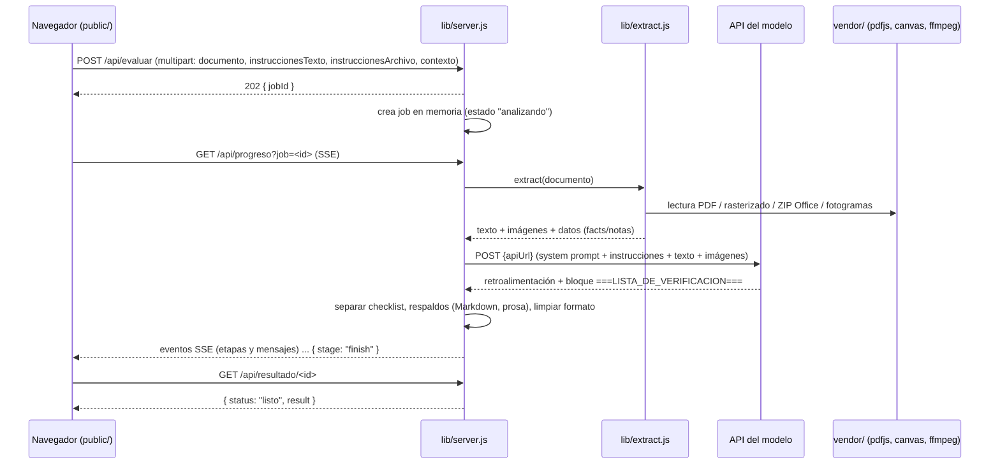

# Arquitectura — Instructor de Logística 2.0.0

Documento técnico del funcionamiento interno. Describe el flujo real de una
evaluación, el papel de cada módulo de `lib/` y las decisiones de diseño.

## 1. Principios

- **Aplicación local de un solo proceso.** El servidor HTTP (`lib/server.js`) y
  la interfaz (`public/`) corren en el equipo del usuario; no hay backend remoto
  propio. Lo único externo es la API del modelo de IA que genera la
  retroalimentación.
- **Sin dependencias npm en el código.** El servidor usa solo módulos nativos
  de Node (`http`, `FormData`, `fetch`, `zlib`, `child_process`). Las piezas
  binarias (`pdfjs-dist`, `@napi-rs/canvas`, `ffmpeg`) viven en `vendor/` y se
  instalan con `tools/preparar-vendor.ps1` con versiones fijadas.
- **Interfaz 100 % offline.** HTML, CSS y JS propios, sin CDN, sin fuentes ni
  imágenes remotas. El navegador solo pide archivos a `127.0.0.1:5599`.
- **Un trabajo de evaluación por petición**, con progreso en vivo por SSE y un
  respaldo por sondeo (`GET /api/resultado/<id>`) si el flujo en vivo se corta.

## 2. Vista general del flujo

Además, la interfaz consulta `GET /api/estado` periódicamente (cada 20 s según
el comportamiento de la versión original) para mostrar si el servidor local
sigue vivo.

## 3. Recorrido de una evaluación

1. **Subida.** El navegador envía `multipart/form-data` a `POST /api/evaluar`
   con `documento`, `instruccionesTexto`, `instruccionesArchivo` y `contexto`.
   El servidor valida que haya documento, crea un `job` (id aleatorio de 8
   bytes) y responde `202 { jobId, status }`. El análisis sigue en segundo plano.
2. **Archivo del documento.** Se guarda en
   `data/tmp/jobs/<jobId>/documento/` con un nombre saneado. El nombre, tamaño
   y tipo se informan en `result.document`.
3. **Instrucciones.** El texto escrito y el archivo de instrucciones (si lo hay)
   se combinan. El archivo se extrae con el mismo motor que el documento; si es
   un PDF escaneado o una imagen sin texto, se transcribe con visión
   (`evaluateInstructionsImage`, máx. 8 imágenes). Sin instrucciones se aplica un
   criterio general de logística.
4. **Extracción.** `extract()` detecta el tipo (extensión + cabecera del
   archivo), elige la ruta de lectura y produce un objeto `Content` con:
   - `text`: texto normalizado para el prompt,
   - `images`: adjuntos visuales (ruta, etiqueta, data URL),
   - `facts`: datos objetivos (páginas, palabras, hojas, diapositivas, duración,
     resolución, audio, etc.),
   - `notes`: avisos legibles (recortes, formatos parciales, cupos).
5. **Evaluación.** `evaluate()` arma el mensaje de sistema (rol de instructor y
   formato obligatorio) y el mensaje de usuario (instrucciones, datos, texto,
   obligación de revisar las imágenes, contexto). Envía hasta 22 imágenes como
   `image_url` al endpoint compatible con OpenAI. La respuesta se parte en
   retroalimentación escrita + bloque JSON de lista de verificación.
6. **Respaldos de la lista.** Si el bloque no viene o está mal formado:
   - se detecta una tabla Markdown en el texto y se convierte
     (`extraerTablaMarkdown`);
   - si la calificación viene en párrafos, se reconstruye
     (`extraerListaEnProsa`);
   - si aun así no hay lista, `checklist` queda en `null`, se conserva la
     retroalimentación y se envía `checklistAviso` a la interfaz. El resultado
     nunca se rompe por la tabla.
7. **Resultado.** El servidor guarda `feedback`, `checklist`, `checklistAviso`,
   `model`, `usage`, `estimate`, `document`, `instructions` (resumen),
   `elapsedMs`; emite `{ stage: "finish" }` y cierra los SSE. La interfaz pide
   `GET /api/resultado/<id>`, pinta el texto y dibuja la tabla.
8. **Limpieza.** Al terminar (éxito o error) se cierra el trabajo y se borra su
   carpeta temporal. Los trabajos en memoria se eliminan a las 2 horas (revisión
   cada 15 min) y el servidor no persiste nada en disco más allá de `data/tmp`.

## 4. Endpoints

| Método | Ruta | Función |
|---|---|---|
| `POST` | `/api/evaluar` | Recibe el formulario, crea el job y responde `202`. |
| `GET` | `/api/progreso?job=<id>` | SSE con los eventos del job. Reenvía los ya ocurridos; un `ping` cada 15 s mantiene la conexión. |
| `GET` | `/api/resultado/<id>` | `202` mientras trabaja, `200` con `{status:"listo"}` y el resultado, o `{status:"error"}`. |
| `GET` | `/api/estado` | Estado del servidor: modelo, si hay clave, si existe `ffmpeg` y lista de formatos. |
| `GET` | resto | Sirve `public/` con `Cache-Control: no-store` (evita versiones viejas). |

El servidor usa `server.headersTimeout = 0` y `requestTimeout = 0` para no
cortar subidas ni evaluaciones largas. Si el puerto configurado está ocupado,
intenta los siguientes (hasta 12 intentos) y muestra la URL final en consola.

## 5. Módulos de `lib/`

| Módulo | Responsabilidad |
|---|---|
| `config.js` | Configuración central, rutas (`root`, `data`, `uploads`, `tmp`, `vendor`), clave de API y límites. Crea `data/`, `data/uploads/` y `data/tmp/` al cargarse. |
| `server.js` | HTTP, rutas, `FormData`, trabajos en memoria, SSE, estáticos y apertura del navegador (`--open`, `NO_OPEN`). |
| `extract.js` | Orquestador: detecta el tipo y enruta a PDF, Office, ODF, legacy, imagen, video o texto. Construye `Content`. |
| `content.js` | Detección de tipo por extensión/cabecera, normalización de texto y clase `Content` (texto, imágenes, facts, notas). |
| `pdf.js` | Carga PDF.js legacy desde `vendor/`, lee texto por página y expone `renderPage`. Factories de disco para fuentes/CMaps/wasm (Node no puede `fetch` `file://`). |
| `raster.js` | Rasteriza páginas a JPEG/PNG con `@napi-rs/canvas` a `pageMaxWidth`. |
| `images.js` | Política de imágenes: descarta solo lo decorativo (<32×32, líneas, duplicadas) y conserva diagramas, capturas, firmas e iconos. |
| `office.js` | DOCX/XLSX/PPTX (OOXML) y ODT/ODS/ODP (ODF) leyendo el ZIP interno; texto, tablas, encabezados, notas y medios incrustados. |
| `zip.js` | Lector ZIP mínimo (EOCD, directorio central, `zlib`) para los formatos Office. |
| `legacy.js` | Recuperación aproximada de texto de `.doc`, `.xls`, `.ppt` y binarios OLE2. |
| `video.js` | Metadatos con `ffmpeg -i`, muestreo uniforme de fotogramas, deduplicación por *hash* perceptual y conversión de imágenes exóticas. |
| `proc.js` | Ejecuta procesos externos capturando salida en archivos (compatible con sandboxes que bloquean tuberías). |
| `llm.js` | Prompt de sistema, mensaje de usuario, llamada a la API, separación y respaldos de la lista de verificación. |

## 6. Límites reales (`lib/config.js`)

| Clave | Valor | Significado |
|---|---|---|
| `limits.uploadBytes` | 300 MB | Tamaño máximo de subida. |
| `limits.maxPages` | 120 | Páginas de PDF que se leen como texto. |
| `limits.maxImages` | 22 | Cupo total de imágenes por evaluación. |
| `limits.maxImagenesIncrustadas` | 16 | Imágenes incrustadas de Word/PPT/Excel/ODF. |
| `limits.maxPaginas` | 14 | Páginas de PDF rasterizadas como máximo. |
| `limits.maxVideoFrames` | 18 | Fotogramas de video. |
| `limits.maxTextChars` | 120 000 | Caracteres leídos de archivos de texto plano (se recorta el resto). |
| `limits.pageMaxWidth` | 1650 px | Ancho de render de páginas. |
| `limits.imageWidth` | 1800 px | Ancho máximo de imágenes de Office. |
| `limits.videoFrameWidth` | 768 px | Ancho de los fotogramas. |
| `limits.pageQuality` | 0.9 | Calidad JPEG de las páginas. |

Otros topes en el código (no configurables): CSV se limita a las primeras 500
filas; el modelo recibe `max_tokens: 12000` (6000 al transcribir instrucciones);
`temperature: 0.6`; tiempo máximo de respuesta 7 minutos; si la API responde
413 con más de 6 imágenes se reintenta con 6; las instrucciones en imagen se
transcriben con hasta 8 imágenes.

La configuración se lee con esta prioridad: variables de entorno, luego
`data/config.json`, luego credenciales locales `~/.dsh/.credentials.yaml` (solo
la clave). Ver el README para las variables y el ejemplo
`data/config.example.json`.

## 7. Decisiones de diseño

- **Extraer y no pedir datos.** El valor del producto es que el usuario solo
  suba el archivo. Por eso la extracción es amplia (texto + imágenes + contexto)
  y los avisos de recorte son explícitos.
- **Multimodal con presupuesto.** El cupo de 22 imágenes (16 incrustadas + 14
  páginas como máximo compartiendo cupo) equilibra cobertura visual y costo. Las
  páginas completas solo se rasterizan cuando aportan (PDF escaneado o con
  páginas/imágenes relevantes); un PDF solo texto no gasta cupo en imágenes.
- **La tabla es datos, no texto.** El modelo entrega la lista como JSON entre
  marcas; la interfaz la dibuja. Así el formato es consistente, se controlan
  columnas/totales y se evita duplicar la tabla como Markdown. Los respaldos
  cubren a los modelos que igual escriben texto.
- **Interfaz sin build.** Un único `app.js` (ES2020) y CSS moderno con
  versiones anti-caché `?v=6`. No hay paso de compilación ni dependencias de
  front-end; el servidor sirve los archivos tal cual.
- **Trabajos en memoria.** Para un uso local monousuario no hace falta una cola
  persistente ni una base de datos: un `Map` con SSE y limpieza por tiempo es
  suficiente. Reiniciar el servidor descarta evaluaciones en curso.
- **Vendor fijado y fuera de Git.** Los binarios suman más de 100 MB y cambian
  poco; el repositorio guarda el instalador (`tools/preparar-vendor.ps1`) y las
  versiones exactas, no los binarios. El ZIP de distribución sí los incluye.
- **Compatibilidad de procesos.** `proc.js` evita tuberías (`stdio: pipe`) y
  redirige a archivos porque algunos sandboxes las bloquean; así `ffmpeg`
  funciona en más entornos.

## 8. Limitaciones conocidas

- **Sin OCR propio.** Los PDF escaneados se rasterizan y los interpreta el
  modelo de visión; si el escaneo es ilegible, la evaluación lo refleja.
- **Formatos antiguos de Office** (`.doc`, `.xls`, `.ppt`) se recuperan de forma
  aproximada: puede faltar contenido o tablas.
- **El audio de los videos no se transcribe.** Solo se analizan fotogramas.
- **Windows x64.** Los binarios instalados por el script son de esa
  plataforma; Linux/macOS requerirían sus propios binarios de canvas y ffmpeg.
- **Requiere internet para evaluar** (llamada al modelo) y para instalar
  `vendor/` la primera vez. FFmpeg se obtiene del paquete npm fijado
  `ffmpeg-static@5.2.0` (build 6.0 essentials de gyan.dev) y, como respaldo, del
  ZIP release de gyan.dev; si la red bloquea ambos, hay que copiar `ffmpeg.exe`
  manualmente en `vendor/bin/`.
- **Un solo usuario y una evaluación pesada a la vez** en la práctica: el
  servidor atiende peticiones concurrentes, pero comparten CPU, memoria y cupo
  de API.
- `pdfjs-dist@6.3.289` declara Node 22.13+; el proyecto fija ese mínimo
  (`engines.node: >=22.13.0`) y se ha probado con Node 24. Ver `vendor/README.md`.
